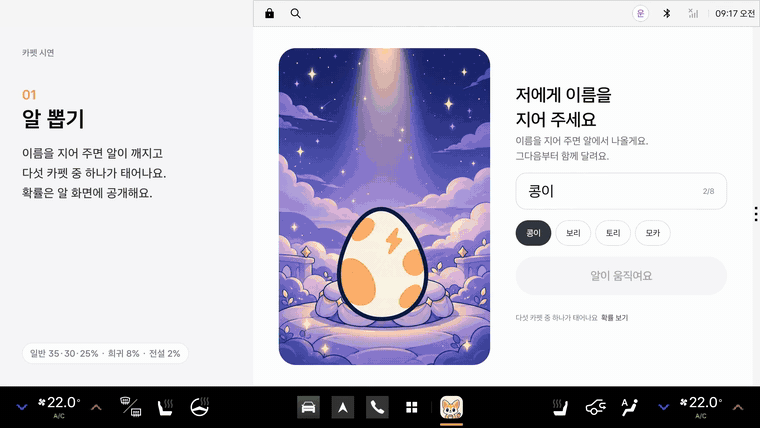
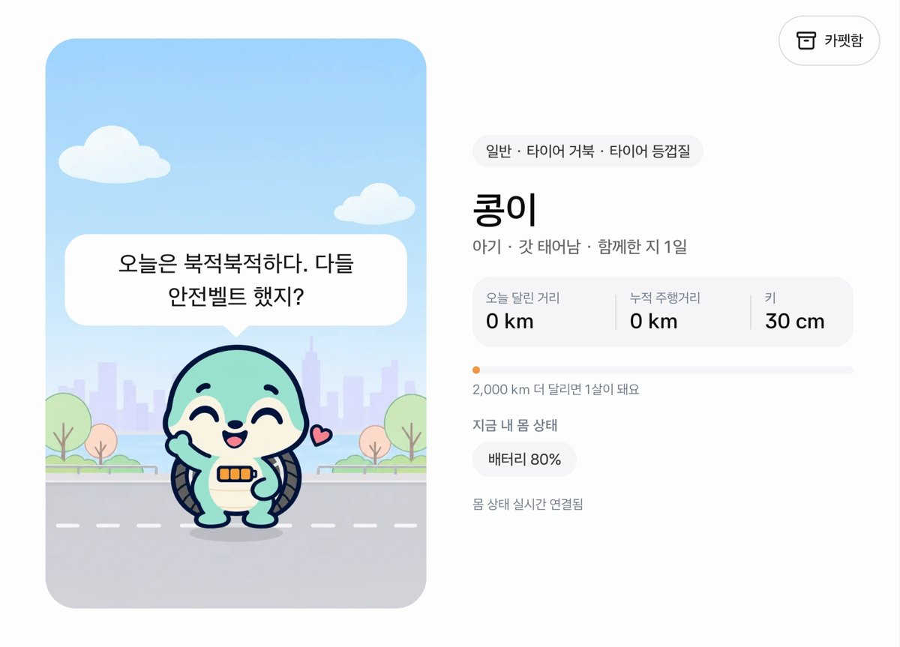
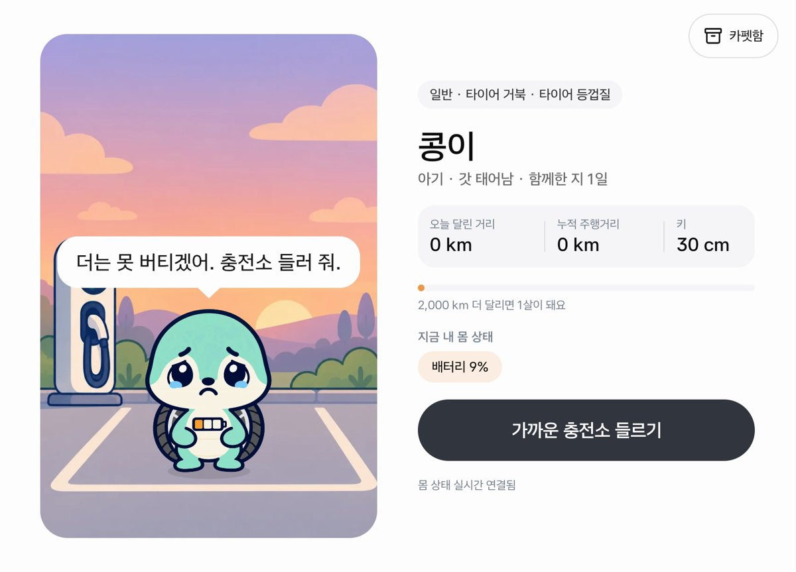
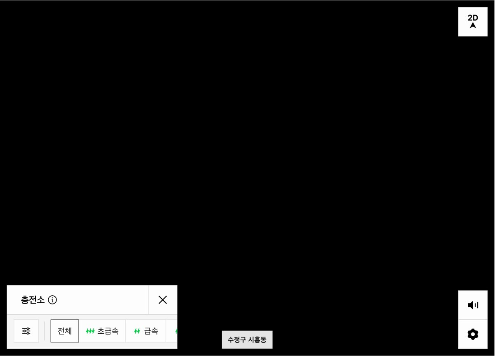
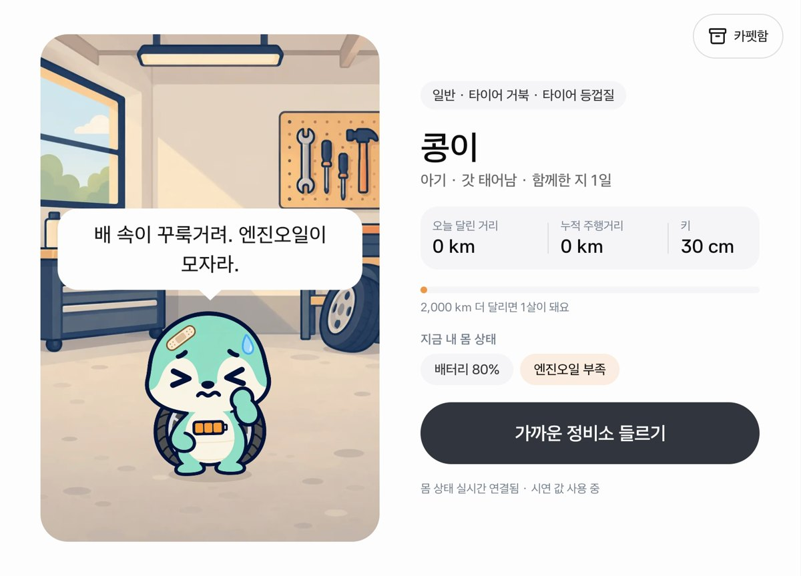
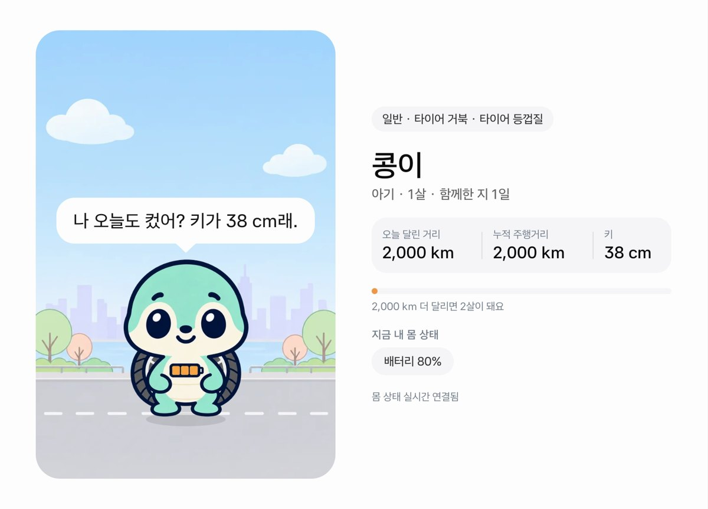
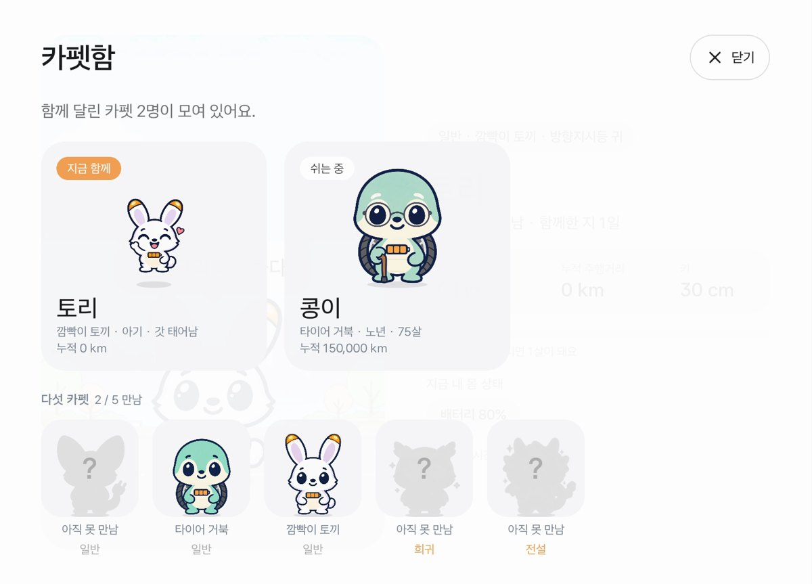

# 카펫 (CarPet)

**내 차를 캐릭터로 만들어 생명을 불어넣는 Pleos Connect 앱.**
이름을 지어 주면 알에서 깨어나 차량 상태를 캐릭터의 감정으로 보여 주고 함께 달린 거리만큼 자랍니다.

현대자동차그룹 차량용 앱 개발 공모전 출품작

[](docs/demo/carpet_demo.mp4)

| 자료 | 위치 |
|---|---|
| APK (release) | [`apk/CarPet_카펫_release.apk`](apk/CarPet_카펫_release.apk) · [GitHub Release](https://github.com/xpdlf1004/carpet/releases/latest) |
| 시연 영상 (2분 4초) | [`docs/demo/carpet_demo.mp4`](docs/demo/carpet_demo.mp4) |
| 화면 시안 (PDF) | [`docs/카펫_화면시안.pdf`](docs/카펫_화면시안.pdf) |

## 무엇을 하나

카펫은 차 그 자체입니다. 차의 몸 상태를 Vehicle SDK로 읽어 감정으로 바꾸고, 해야 할 일이 있으면 버튼 하나로 Pleos 내비에 넘깁니다.

| 감정 | 차량 신호 | 권한 | 이어지는 행동 |
|---|---|---|---|
| 배고픔 | 배터리 잔량 `registerEvBatteryStateOfCharge` | CAR_ENERGY | 내비가 근처 충전소 목록을 연다 (NaviHelper) |
| 아픔 | 엔진오일·브레이크액 수준, 워셔액 부족, 출력 저하 경고 | CAR_SAFETY | 내비가 정비소 검색을 연다 (블루핸즈·오토큐) |
| 반가움 | 좌석 착석 `registerSeatOccupancy` | CAR_SEATS | 탈 때마다 시간대·동승자에 맞춘 인사 |
| 비 맞음 | 와이퍼 상태 `registerWiperState` | CAR_WINDOWS | 비 오는 장면, 조심하자는 말 |
| 성장 | 누적 주행거리 `registerDistanceDriven` | CAR_DRIVE | 2,000 km = 1살, 키, 생일·새 모습 축하 |

- **알 뽑기**: 첫 탑승 때 알에게 이름을 지어 주면 다섯 카펫 중 하나가 태어납니다. 확률은 화면에 공개합니다(플러그 여우 35%, 타이어 거북 30%, 깜빡이 토끼 25%, 헤드라이트 부엉이 8%, 터보 드래곤 2%).
- **함께 자라기**: 나이는 차의 누적 주행거리와 같이 갑니다. 아기 → 어린이(5,000 km) → 청년(3만 km) → 중년(8만 km) → 노년(15만 km). 홈에는 오늘 달린 거리·누적 주행거리·키와 다음 생일까지 남은 거리를 보여 줍니다.
- **카펫함**: 차를 바꾸면 주행거리가 0이 되므로 새 알이 깨어나고, 먼저 키운 카펫은 그때 모습 그대로 카펫함으로 옮겨 갑니다. 다섯 카펫 도감도 여기서 채웁니다.

## 화면

| | | |
|---|---|---|
|  |  |  |
| 첫 탑승: 알이 이름을 부탁한다 | 알 뽑기 | 홈: 머리 위 말풍선과 성장 기록 |
|  |  |  |
| 배고픔 (배터리 9%) | 버튼 하나로 근처 충전소 | 아픔 (엔진오일 부족) |
|  |  |  |
| 정비소 검색 (블루핸즈·오토큐) | 2,000 km 첫 돌 | 카펫함과 도감 |

## 실행 방법

1. **에뮬레이터 준비**: Android Studio에서 Pleos Connect Emulator(v2.1) 시스템 이미지로 AVD를 만들어 실행합니다.
2. **APK 설치**
   ```bash
   adb install apk/CarPet_카펫_release.apk
   ```
3. **앱 열기**: Pleos 화면 아래 독에서 카펫 아이콘을 누릅니다(앱 목록에도 있습니다). 처음 열면 알이 이름을 지어 달라고 합니다. 추천 이름을 누르고 「이 이름으로 깨우기」를 누르면 카펫이 태어납니다.
4. **차 상태 바꾸기 (Virtual Console)**
   ```bash
   adb forward tcp:8088 tcp:8088   # 브라우저에서 http://127.0.0.1:8088
   ```
   | 콘솔 항목 | 카펫 반응 |
   |---|---|
   | Battery SOC 20% 이하 | 배고픔 → 「가까운 충전소 들르기」 |
   | Windshield Wiper Switch Low/High | 비 맞음 |
   | Odometer 2,000 km 이상 | 첫 돌, 나이·키 증가 (3만 km 청년, 15만 km 노년) |
   | Seat Occupancy | 탈 때 인사, 동승자 수에 따라 말이 바뀜 |
5. **시연 패널**: 엔진오일·브레이크액·워셔액은 Virtual Console에 항목이 없습니다. 앱 화면 **왼쪽 위 모서리를 길게 누르면** 시연 패널이 열리고, 여기서 값을 덮어쓰거나 주행거리 프리셋, 「150 km / 2000 km 달리기」, 「새 차로 바꾸기」(카펫함 흐름)를 쓸 수 있습니다.

## 테스트 환경 및 필요한 설정

| 항목 | 값 |
|---|---|
| 에뮬레이터 | Pleos Connect Emulator v2.1 (Android 14, 2560×1440, 160 dpi) |
| 호스트 | macOS (Apple silicon), Android Studio, Android Emulator |
| AVD 그래픽 | `hw.gpu.mode=swiftshader_indirect` (호스트 GPU 모드는 부팅 직후 멈추는 경우가 있었음) |
| 앱 | `com.carpet.app`, minSdk 28 · targetSdk 35, 가로 화면 |
| 권한 | `CAR_ENERGY`, `CAR_DRIVE`, `CAR_SEATS`, `CAR_WINDOWS`, `CAR_SAFETY`, `NAVI_CUSTOM_MAP` (모두 일반 권한, 설치 시 허용) |
| SDK | Pleos Vehicle SDK 2.3.2, Pleos NaviHelper 3.0.5 |

- 충전소·정비소 버튼은 Pleos 내비가 실행 중이어야 동작합니다. 에뮬레이터를 막 켰다면 내비가 뜰 때까지 기다립니다.
- Pleos는 앱을 user 10으로 실행합니다. 다시 설치하면 내비가 앞으로 올 수 있으니 독에서 카펫 아이콘을 눌러 앞으로 가져옵니다.
- Virtual Console에서는 주행거리를 줄일 수 없습니다. 0 km부터 다시 보려면 에뮬레이터를 다시 시작하거나 시연 패널의 「0」 프리셋을 씁니다.
- 앱 데이터(이름·카펫함·주행 기록)는 기기 안에만 저장합니다. 처음부터 다시 보려면 시연 패널의 「처음부터 다시」를 누릅니다.

## 빌드

JDK 17, Android SDK 35.

```bash
./gradlew assembleRelease     # app/build/outputs/apk/release/app-release.apk
./gradlew testDebugUnitTest   # 단위 테스트 (감정·성장·대사·주행 기록)
```

release 서명 키는 저장소 밖(`~/.config/carpet/keystore.properties` 또는 환경 변수 `CARPET_KEYSTORE`)에서 읽습니다. 키가 없으면 debug 키로 서명해 누구나 빌드할 수 있습니다.

## 구조

```
app/src/main/java/com/carpet/app/
  vehicle/  PleosVehicleSource  Vehicle SDK 구독(별도 스레드), 시연 값 덮어쓰기
            PleosNavi           NaviHelper로 내비 화면 요청(근처 충전소, 정비소 검색)
  domain/   EmotionEngine·Lines 신호 → 감정·상황별 대사·행동 제안
            Growth              주행거리 → 단계·나이·키·다음 생일·축하
            DriveDay            오늘 달린 거리, 며칠 만의 탑승
            Species             다섯 카펫과 뽑기 확률
  data/     PetProfileStore     지금 카펫, 카펫함, 주행 기록 (기기 안 저장)
  ui/       알 → 인사 → 홈, 축하·작별 화면, 카펫함, 시연 패널
app/src/main/res/drawable-nodpi/  pet_<카펫>_<단계>_<감정>.webp, bg_<장면>.webp
```

캐릭터와 배경 일러스트는 Codex 이미지 생성으로 만들었습니다. 숨쉬기·깜빡임·통통 튀기·흔들림, 키에 따른 크기 변화는 코드로 줍니다.
